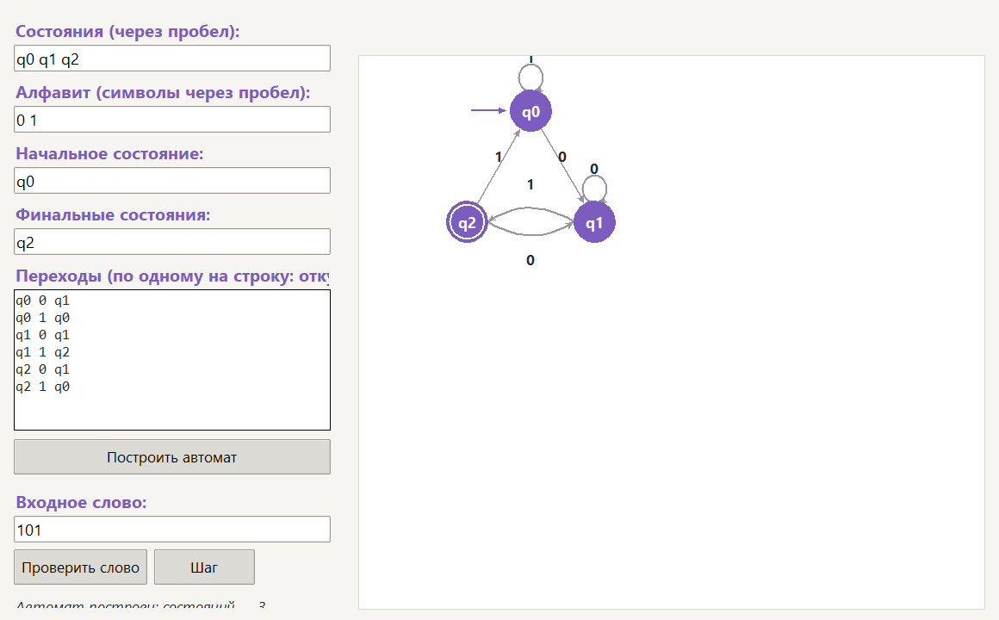

# ⚙️ Finite Automaton — конечный автомат

Десктопное приложение на **Python (tkinter)** для моделирования **конечного автомата**: задайте состояния, алфавит и переходы — и программа нарисует автомат графом, а затем **пошагово проанимирует** разбор входного слова, подсвечивая текущее состояние.



## ✨ Возможности

- Задание автомата в текстовом виде: состояния, алфавит, начальное и финальные состояния, список переходов
- **Недетерминированные автоматы** поддерживаются из коробки — состояние может иметь несколько переходов по одному символу
- Наглядный **граф автомата**: петли, дуги в обе стороны, метки переходов, двойная обводка финальных состояний, стрелка на начальное состояние
- **Анимация разбора слова**: текущие состояния подсвечиваются, слово отображается с указателем позиции
- Пошаговый режим — кнопка **«Шаг»** для ручного прохода по слову
- Понятный вердикт: слово допускается, автомат застрял или остановился не в финальном состоянии
- Проверка корректности описания: неизвестные состояния, символы вне алфавита, ошибки формата
- Без внешних зависимостей — только стандартная библиотека Python

## 🛠️ Технологии

- **Python 3.10+**
- **tkinter / ttk** — интерфейс, отрисовка графа и анимация на Canvas

## 📋 Требования

- Python 3.10 или выше (tkinter входит в стандартную поставку для Windows и macOS; на Linux может потребоваться пакет `python3-tk`)

## 🚀 Запуск

Клонируйте репозиторий:

```bash
git clone https://github.com/ваш-username/finite-automaton.git
cd finite-automaton
```

Запустите приложение:

```bash
python app.py
```

## 🎯 Использование

1. Заполните поля описания автомата (при запуске подставлен пример — автомат, распознающий слова, содержащие подслово `01`):
   - **Состояния** — через пробел, например `q0 q1 q2`;
   - **Алфавит** — символы через пробел, например `0 1`;
   - **Переходы** — по одному на строку в формате `откуда символ куда`, например `q0 0 q1`.
2. Нажмите **«Построить автомат»** — справа появится граф.
3. Введите входное слово и нажмите **«Проверить слово»** — разбор анимируется с подсветкой текущего состояния. Кнопка **«Шаг»** переключает состояния вручную.

### Пример

Автомат из примера выше отвечает:

| Слово | Результат |
| ----- | --------- |
| `101` | ✅ допускается |
| `001` | ✅ допускается |
| `110` | ❌ не допускается |

## 🔬 Как это работает

- Переходы хранятся в словаре `(состояние, символ) → множество целевых состояний`, поэтому один символ может вести в несколько состояний (недетерминизм).
- Текущая конфигурация — **множество активных состояний**. На каждом символе оно заменяется объединением образов всех своих элементов.
- Слово допускается, если после чтения всей строки множество активных состояний пересекается с множеством финальных.
- Пустое множество означает, что автомат «застрял» — разбор завершается досрочно.

## 📁 Структура проекта

```
finite-automaton/
├── app.py            # Окно приложения: ввод, граф, анимация разбора
├── automaton.py      # Модель конечного автомата
├── docs/
│   └── screenshot.png
└── README.md
```
